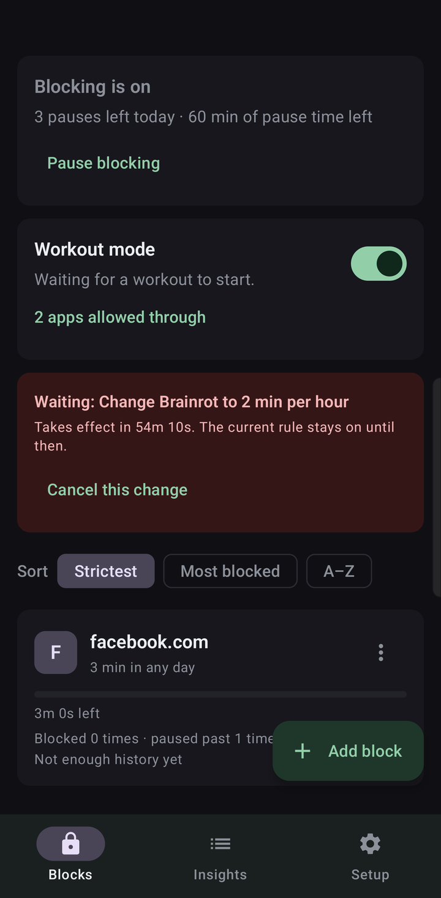
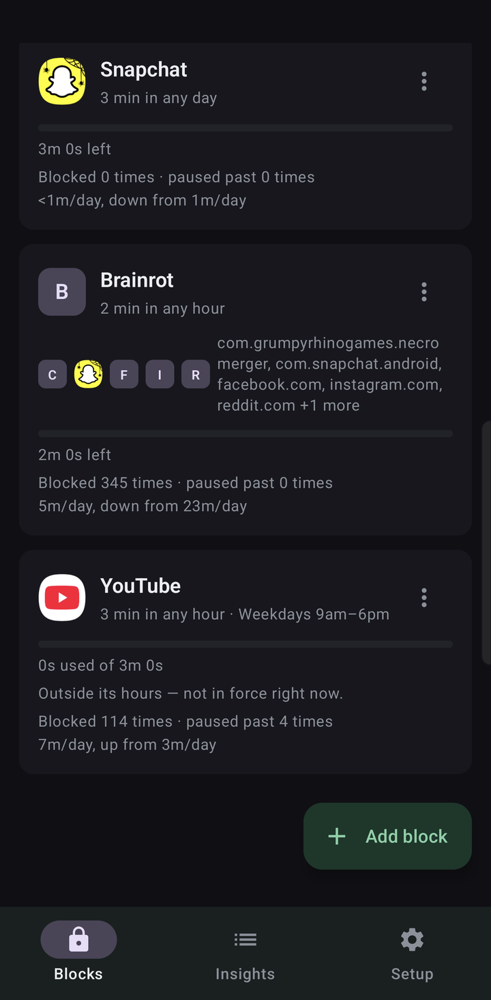
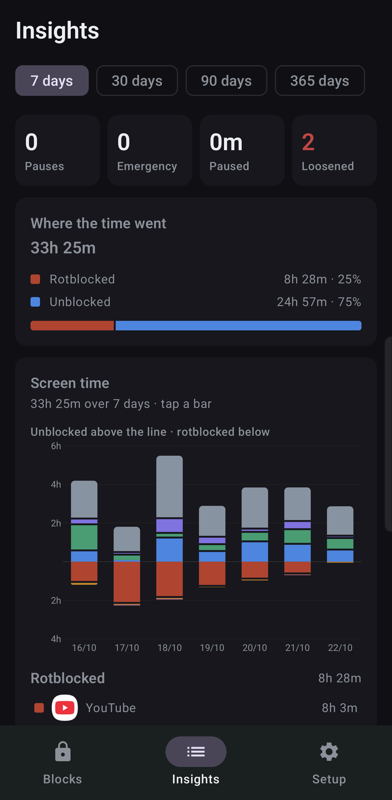
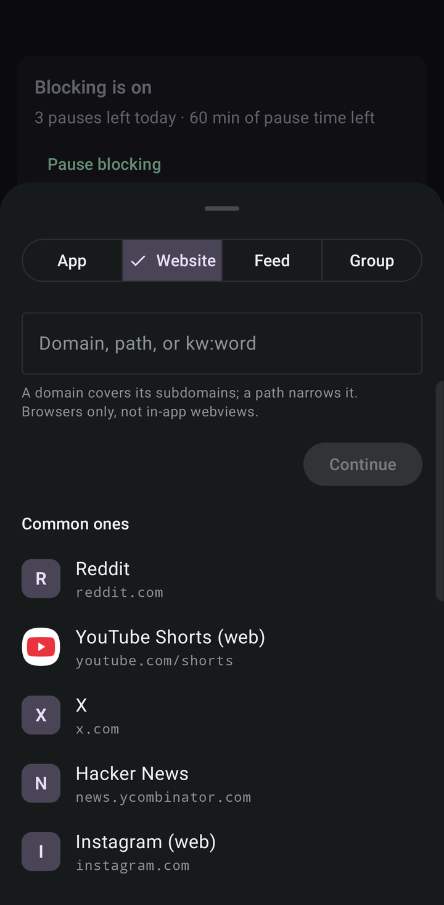
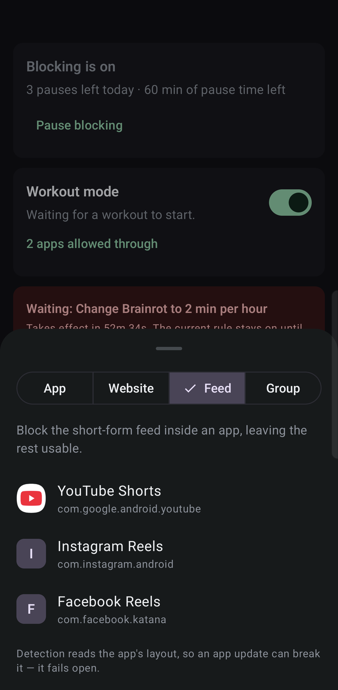
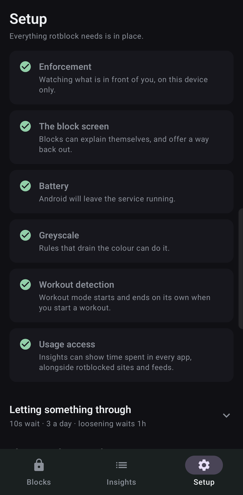

# rotblock

[](https://github.com/ethanez713/rotblock/actions/workflows/ci.yml)

**An app, website and feed blocker for Android that turns itself back on.** Every pause,
quota and loosened rule is a deadline saved to disk, so a crash, a reboot or a forgotten
"just for a minute" always ends with blocking back in force. No network permission, no
account, no subscription.

<table>
  <tr>
    <td width="33%"></td>
    <td width="33%"></td>
    <td width="33%"></td>
  </tr>
  <tr>
    <td valign="top"><b>Blocks.</b> Pauses left today, workout mode, and a loosening change waiting out its delay before it applies. It can still be cancelled.</td>
    <td valign="top"><b>Rules.</b> A group sharing one quota across apps and sites, rolling quotas such as 3 minutes in any hour, a weekday 9–6 schedule, and how often each rule has blocked.</td>
    <td valign="top"><b>Insights.</b> Where the time went, rotblocked against unblocked, with each day's screen time split above and below the line.</td>
  </tr>
  <tr>
    <td width="33%"></td>
    <td width="33%"></td>
    <td width="33%"></td>
  </tr>
  <tr>
    <td valign="top"><b>Add a website</b> by domain, by path such as <code>youtube.com/shorts</code>, or by keyword.</td>
    <td valign="top"><b>Add a feed.</b> Block Shorts or Reels inside an app and keep the rest of it.</td>
    <td valign="top"><b>Setup</b> checks each permission and the block screen itself, so a silently broken enforcement path shows up.</td>
  </tr>
</table>

## What it does

- **Blocks apps**, outright or on a rolling time quota ("3 minutes out of any 60"). The window is
  trailing, so time trickles back as old sessions age out rather than resetting on the clock hour.
- **Blocks websites** by domain, path prefix (`youtube.com/shorts`), or keyword. The read comes
  from the browser, so it works regardless of DNS or VPN settings.
- **Blocks short-form feeds inside apps** you otherwise want to keep, like Reels, by recognising the
  feed's own view hierarchy.
- **Schedules**: any rule can be limited to particular hours on particular days ("block YouTube
  10–6, weekdays"), with as many stretches as you want and overnight windows that wrap past
  midnight. Outside its hours a rule does nothing at all, and nothing spent there counts against
  its quota.
- **Friction**: a few seconds of blank countdown before a chosen app opens. It always lets you
  through; it just puts a gap between the reflex and the feed.
- **Greyscale** while a target is open, if you grant the ADB permission for it.
- **Pauses** with a cooldown and a daily budget, and an audit log of every one you took.
- **Insights**: where the time actually went.

## Why it stays on

**Nothing fails open.** Every relaxation — a pause, a quota, a queued policy edit — is a *deadline
persisted to disk*, and the decision function is a pure fold over those timestamps. There is no
"blocking is currently off" flag and no timer that turns blocking back on.

So a crash, a force-stop, a reboot, or a background job that never runs all resume blocking on
their own. That is the entire point: the failure this exists to prevent is *"disabled a policy for
one minute, forgot about it for three weeks."*

The corollary is that it has to be cheap enough to leave enabled — an always-on accessibility
service that shows up in the battery screen gets switched off, and a blocker that gets switched off
blocks nothing. Battery is treated as a correctness requirement, one rank below never failing open.

## Install

It is not on any app store: build it and sideload it. JDK 17 and an Android SDK with
platform 36; no Android Studio needed.

```
./gradlew assembleDebug
```

Android 13+ hides accessibility for sideloaded apps behind "Restricted settings", so a few grants
have to come over ADB:

```
adb install -r app/build/outputs/apk/debug/app-debug.apk
adb shell appops set com.ezhou.rotblock ACCESS_RESTRICTED_SETTINGS allow
adb shell appops set com.ezhou.rotblock SYSTEM_ALERT_WINDOW allow
adb shell pm grant com.ezhou.rotblock android.permission.WRITE_SECURE_SETTINGS   # greyscale only
```

Then enable **rotblock enforcement** in Settings → Accessibility. On Samsung/One UI devices also set
Battery → **Unrestricted** and remove rotblock from "Deep sleeping apps", or the system kills it.

## What it needs, and why

| Permission | Why |
|---|---|
| Accessibility service | The only enforcement path: which app is in the foreground, and the address bar text in browsers. |
| `SYSTEM_ALERT_WINDOW` | Draws the block screen. Without it, blocking degrades to ejecting you to the home screen. |
| `POST_NOTIFICATIONS` | The countdown notification, which is off by default. |
| `WRITE_SECURE_SETTINGS` | Greyscale only. Grantable solely over ADB; the app works fine without it. |
| `PACKAGE_USAGE_STATS` | Whole-phone time on Insights. An app-op (`GET_USAGE_STATS`), granted in Settings → Usage access. Enforcement does not use it. Without it, Insights falls back to the ledger. |
| `<queries>`, not a permission | Two scoped lookups — what the user can launch, for the app picker, and who handles a given website, for a rule's logo. `QUERY_ALL_PACKAGES` was removed; Play refuses it when a scoped declaration does the job. |

Quota enforcement reads rotblock's own ledger. The ledger has nothing to say about an app before a
rule covering it existed, and a site with no rule is never recorded. Whole-phone time on Insights
is a separate read of `UsageStatsManager`, and only when usage access is granted.

There is deliberately **no `INTERNET` permission**, and no networking library in the dependency
tree. Cloud backup and device-to-device transfer are both excluded in
`app/src/main/res/xml/data_extraction_rules.xml`.

Debug builds log the URLs they inspect to logcat, behind `BuildConfig.DEBUG`. Release builds omit
those traces. A failed audit write or a failed greyscale change still logs the error.

## How it works

One accessibility service is the only enforcement path. It reads which app is in front,
and in browsers which page, then asks a pure function of the saved rules and timestamps
whether to block. Nothing wakes the phone: no alarms, no background jobs, no foreground
service. The architecture, how a web page is identified when the address bar is hidden,
and the trade-offs are in [docs/DESIGN.md](docs/DESIGN.md).

The unit tests are pure JVM (`./gradlew testDebugUnitTest`) and cover the logic that has
to be right: rolling-window arithmetic at the window edges, quota boundaries, schedule
windows across midnight and daylight-saving changes, and which way a screen read fails
when it cannot see.

## License

The app is released under the [MIT License](LICENSE). Copyright (c) 2026 Ethan Zhou.

The fonts under `app/src/main/res/font` are bundled under the [SIL Open Font License](https://scripts.sil.org/OFL)
1.1, which is separate from the MIT grant. The license texts are in `THIRD_PARTY_LICENSES/`:

| Font | Files | Notice |
|---|---|---|
| Piazzolla | `piazzolla.ttf` | [`ofl_piazzolla.txt`](THIRD_PARTY_LICENSES/ofl_piazzolla.txt) |
| Instrument Sans | `instrument_sans.ttf` | [`ofl_instrument_sans.txt`](THIRD_PARTY_LICENSES/ofl_instrument_sans.txt) |
| IBM Plex Mono | `ibm_plex_mono_regular.ttf`, `ibm_plex_mono_medium.ttf` | [`ofl_ibm_plex_mono.txt`](THIRD_PARTY_LICENSES/ofl_ibm_plex_mono.txt) |

IBM Plex Mono is published with the reserved font name "Plex".

## Status

Personal project, built for one phone and used daily. Published as a reference — it is not on any
app store, and there is no release signing config in the repo.
