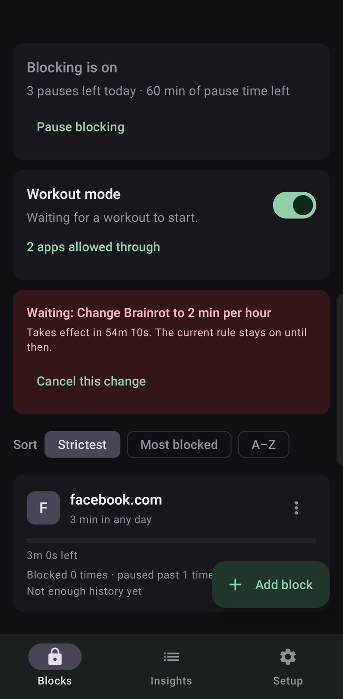
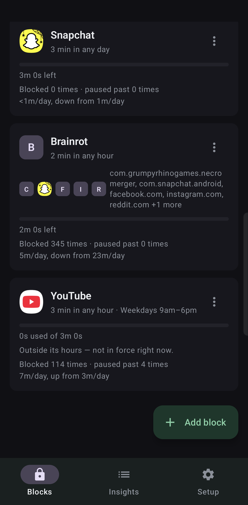
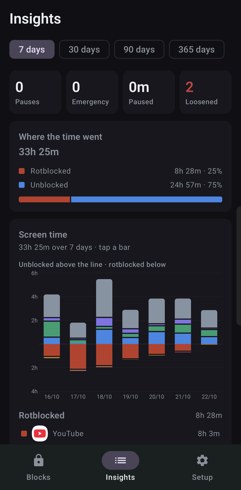
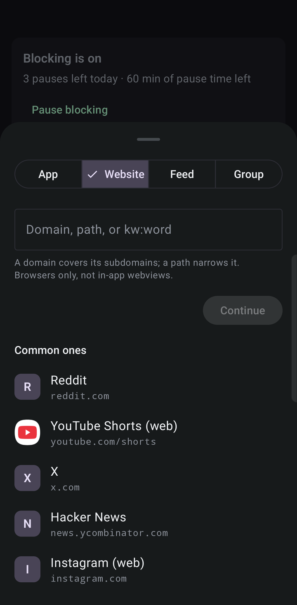
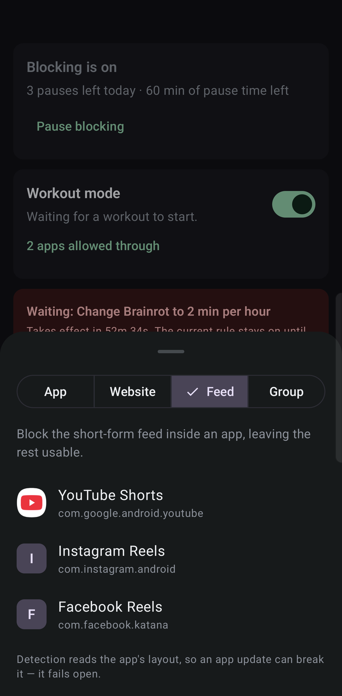
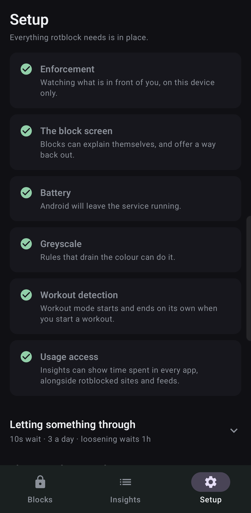
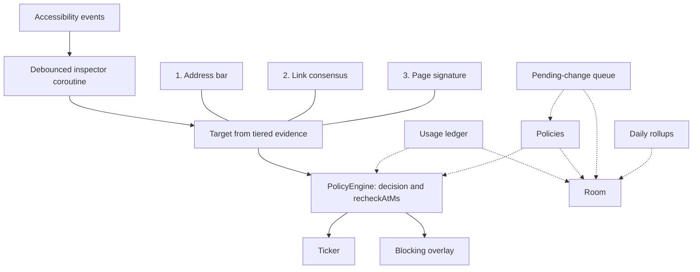

# rotblock

[](https://github.com/ethanez713/rotblock/actions/workflows/ci.yml)

A local app and website blocker for Android, built to replace a paid blocker subscription.

Kotlin + Compose, single `:app` module, sideloaded. **No network permission**, no accounts, no
sync — the usage history and audit log physically cannot leave the device, because the app has no
way to send them anywhere.

## What it does

- **Blocks apps**, outright or on a rolling time quota ("3 minutes out of any 60"). The window is
  trailing, so time trickles back as old sessions age out rather than resetting on the clock hour.
- **Blocks websites** by domain, path prefix (`youtube.com/shorts`), or keyword. The read comes
  from the browser, so it works regardless of DNS or VPN settings.
- **Blocks short-form feeds inside apps** you otherwise want to keep, like Reels, by recognising the
  feed's own view hierarchy.
- **Schedules**: any rule can be limited to particular hours on particular days ("block YouTube
  10–6, weekdays"), with as many stretches as you want and overnight windows that wrap past
  midnight. Outside its hours a rule does nothing at all, and nothing spent there counts against
  its quota.
- **Friction**: a few seconds of blank countdown before a chosen app opens. It always lets you
  through; it just puts a gap between the reflex and the feed.
- **Greyscale** while a target is open, if you grant the ADB permission for it.
- **Pauses** with a cooldown and a daily budget, and an audit log of every one you took.
- **Insights**: where the time actually went.

## Screenshots

<table>
  <tr>
    <td width="33%"></td>
    <td width="33%"></td>
    <td width="33%"></td>
  </tr>
  <tr>
    <td valign="top"><b>Blocks.</b> Pauses left today, workout mode, and a loosening change waiting out its delay before it applies. It can still be cancelled.</td>
    <td valign="top"><b>Rules.</b> A group sharing one quota across apps and sites, rolling quotas such as 3 minutes in any hour, a weekday 9–6 schedule, and how often each rule has blocked.</td>
    <td valign="top"><b>Insights.</b> Where the time went, rotblocked against unblocked, with each day's screen time split above and below the line.</td>
  </tr>
  <tr>
    <td width="33%"></td>
    <td width="33%"></td>
    <td width="33%"></td>
  </tr>
  <tr>
    <td valign="top"><b>Add a website</b> by domain, by path such as <code>youtube.com/shorts</code>, or by keyword.</td>
    <td valign="top"><b>Add a feed.</b> Block Shorts or Reels inside an app and keep the rest of it.</td>
    <td valign="top"><b>Setup</b> checks each permission and the block screen itself, so a silently broken enforcement path shows up.</td>
  </tr>
</table>

## The design constraint everything follows from

**Nothing fails open.** Every relaxation — a pause, a quota, a queued policy edit — is a *deadline
persisted to disk*, and the decision function is a pure fold over those timestamps. There is no
"blocking is currently off" flag and no timer that turns blocking back on.

So a crash, a force-stop, a reboot, or a background job that never runs all resume blocking on
their own. That is the entire point: the failure this exists to prevent is *"disabled a policy for
one minute, forgot about it for three weeks."*

The corollary is that it has to be cheap enough to leave enabled — an always-on accessibility
service that shows up in the battery screen gets switched off, and a blocker that gets switched off
blocks nothing. Battery is treated as a correctness requirement, one rank below never failing open.

## Architecture

`RotblockAccessibilityService` is the only enforcement path. Accessibility callbacks do a set
lookup and hand the package to a conflated channel. The inspector coroutine, off that callback,
debounces and then reads the node tree at most once a second. A sustained scroll collapses
into one read.



The numbered nodes are evidence tiers, strongest first. They are not a pipe every read travels.

1. **Address bar.** A URL parsed out of the bar is a fact about the page. Text that does not parse
   (a half-typed search, a placeholder) is treated as unreadable, and an unreadable read holds the
   current target.
2. **Link consensus.** When the bar is absent — Samsung Internet removes the toolbar from the
   accessibility tree once you scroll — the host the page's own links agree on can acquire a
   target. It takes two consecutive scans of the same package (`LinkCorroboration`), it reports a
   host and no path, and it never overrides a bar that was read. A search-results page is refused
   by name, because every link on it agrees on the thing you searched for.
3. **Page signature.** The weakest tier, and the only one that can carry a path, which is how
   `youtube.com/shorts` can match on a browser whose bar reports a host alone. With the bar
   missing it is consulted *before* the link vote, because a miss falls through and a signature
   can name a path the vote is not allowed to. It may also refine a bar it already agrees with on
   host. It may not contradict one.

A feed whose view ids are on screen wins before any of the three. A read that cannot see answers
`Unreadable` and leaves the current target alone. `AppOnly` is the only answer allowed to clear it.

`PolicyEngine.evaluateAll` folds every policy covering that target — its own rule, and each group
it belongs to — with the ledger sessions and the pause and workout deadlines. The result is a
`Decision` plus `recheckAtMs`, the next time the answer could change with nobody touching the
phone. The service arms one ticker for that deadline. A block draws the overlay. A deadline
elapsing fires no event of its own; the next evaluation is what notices.

Room (`rotblock.db`) holds the policies, usage sessions, audit log, queued edits, and daily usage
rows. The usage ledger is the in-memory cache the service reads, flushed through to
`usage_sessions` so a quota survives a restart. `PendingChangeQueue` is the gate on edits: a
strengthening applies immediately, a weakening is parked until its deadline, and `applyDue` runs
when the service or the UI next looks at policies. `DailyRollup` folds completed days of
whole-phone usage into `daily_usage` from moments that are already awake — unlock, process start,
a tile binding, Insights opening.

### Design decisions

**Fail closed, by storing deadlines.** A pause is a timestamp. A queued weakening is a timestamp.
A quota is the stored sessions folded against the clock. A schedule is the one relaxation that is
not its own row: the wall clock is already durable, so "outside its hours" is derived on every
call, and an unparseable schedule decodes to always-on. After a crash or a reboot the same rows
are still there, so blocking resumes without a job putting it back. The trade-off is silence. Nothing
announces that a pause ran out or a window opened, so every decision owes the caller `recheckAtMs`.
Skip arming the ticker for it and a rule that should have returned simply never does.

**Decisions are pure functions of saved state.** `PolicyEngine` and `RollingQuota` take `nowMs`
and the stored rows. They do not read a timer, a database, or a boolean that says blocking is on.
The trade-off is that "are we blocked right now" means folding those rows again. That is also why
a restart produces the same answer: the inputs did not live in the process.

**No `INTERNET` permission.** The history this app keeps is the sensitive part, and a favicon
fetch would tell a server which sites are blocked. Logos come from an installed app that declares
the host, or from a monogram tile. Cloud backup and device-to-device transfer are excluded in
`app/src/main/res/xml/data_extraction_rules.xml`. The trade-off is no sync, and a website with no
installed app has no real logo.

**Nothing wakes the phone.** No alarms, no `WorkManager`, no wakelocks, no foreground service, no
boot receiver. The system rebinds the accessibility service on its own, so there is nothing to
restore at boot. Queued weakenings and daily rollups run opportunistically, while the process is
already awake, so a weakening that comes due while the phone is asleep waits until something next
looks, and the stricter rule stays in force until then. A finished day of Insights history waits
the same way, for the next unlock or the next time the app is open.

**A failed read holds the target.** `BrowserRegistry` and `FeedRegistry` are view ids that app
updates break. A miss can only fail to acquire a target, so it degrades to not blocked rather than
a crash or a false block. The opposite mistake — treating "I could not see" as "nothing is on
screen" — drops a live target, which is a fail-open. Those two outcomes stay distinct. The
trade-off is that a target acquired and then scrolled stays held until a real read says you left.

[`CLAUDE.md`](CLAUDE.md) is the full design record: the invariants, what breaks them, and the bugs
found on a real device.

## Build

JDK 17 and an Android SDK with platform 36. No Android Studio required.

AGP 8.6.0, Gradle 8.7, Kotlin 2.0.21. `compileSdk` and `targetSdk` are 36, `minSdk` is 29.

```
./gradlew assembleDebug
./gradlew testDebugUnitTest
```

The unit tests are pure JVM and need no device. They cover the logic that has to be right:
rolling-window arithmetic at the window edges, quota boundaries to the millisecond,
weaken-vs-strengthen classification of policy edits, URL rule matching, pause budgets, the 4am day
rollover,
schedule windows including ones that wrap past midnight or straddle a daylight-saving change, and
which way a screen inspection fails when it cannot read anything.

The same unit-test task runs in CI on every push to `master` and on pull requests
(`.github/workflows/ci.yml`).

## Install

Android 13+ hides accessibility for sideloaded apps behind "Restricted settings", so a few grants
have to come over ADB:

```
adb install -r app/build/outputs/apk/debug/app-debug.apk
adb shell appops set com.ezhou.rotblock ACCESS_RESTRICTED_SETTINGS allow
adb shell appops set com.ezhou.rotblock SYSTEM_ALERT_WINDOW allow
adb shell pm grant com.ezhou.rotblock android.permission.WRITE_SECURE_SETTINGS   # greyscale only
```

Then enable **rotblock enforcement** in Settings → Accessibility. On Samsung/One UI devices also set
Battery → **Unrestricted** and remove rotblock from "Deep sleeping apps", or the system kills it.

## What it needs, and why

| Permission | Why |
|---|---|
| Accessibility service | The only enforcement path: which app is in the foreground, and the address bar text in browsers. |
| `SYSTEM_ALERT_WINDOW` | Draws the block screen. Without it, blocking degrades to ejecting you to the home screen. |
| `POST_NOTIFICATIONS` | The countdown notification, which is off by default. |
| `WRITE_SECURE_SETTINGS` | Greyscale only. Grantable solely over ADB; the app works fine without it. |
| `PACKAGE_USAGE_STATS` | Whole-phone time on Insights. An app-op (`GET_USAGE_STATS`), granted in Settings → Usage access. Enforcement does not use it. Without it, Insights falls back to the ledger. |
| `<queries>`, not a permission | Two scoped lookups — what the user can launch, for the app picker, and who handles a given website, for a rule's logo. `QUERY_ALL_PACKAGES` was removed; Play refuses it when a scoped declaration does the job. |

Quota enforcement reads rotblock's own ledger. The ledger has nothing to say about an app before a
rule covering it existed, and a site with no rule is never recorded. Whole-phone time on Insights
is a separate read of `UsageStatsManager`, and only when usage access is granted.

There is deliberately **no `INTERNET` permission**, and no networking library in the dependency
tree. Cloud backup and device-to-device transfer are both excluded in
`app/src/main/res/xml/data_extraction_rules.xml`.

Debug builds log the URLs they inspect to logcat, behind `BuildConfig.DEBUG`. Release builds omit
those traces. A failed audit write or a failed greyscale change still logs the error.

## Fragile by nature

`browser/BrowserRegistry.kt` and `block/FeedRegistry.kt` hold view-ids that app updates break. They
are kept as data rather than scattered constants, and a miss degrades to "not blocked" rather than a
crash or a false block. To find current ids for a browser or feed that has drifted, open it and run:

```
adb shell uiautomator dump /sdcard/w.xml && adb pull /sdcard/w.xml
```

## License

The app is released under the [MIT License](LICENSE). Copyright (c) 2026 Ethan Zhou.

The fonts under `app/src/main/res/font` are bundled under the [SIL Open Font License](https://scripts.sil.org/OFL)
1.1, which is separate from the MIT grant. The license texts are in `THIRD_PARTY_LICENSES/`:

| Font | Files | Notice |
|---|---|---|
| Piazzolla | `piazzolla.ttf` | [`ofl_piazzolla.txt`](THIRD_PARTY_LICENSES/ofl_piazzolla.txt) |
| Instrument Sans | `instrument_sans.ttf` | [`ofl_instrument_sans.txt`](THIRD_PARTY_LICENSES/ofl_instrument_sans.txt) |
| IBM Plex Mono | `ibm_plex_mono_regular.ttf`, `ibm_plex_mono_medium.ttf` | [`ofl_ibm_plex_mono.txt`](THIRD_PARTY_LICENSES/ofl_ibm_plex_mono.txt) |

IBM Plex Mono is published with the reserved font name "Plex".

## Status

Personal project, built for one phone and used daily. Published as a reference — it is not on any
app store, and there is no release signing config in the repo.
