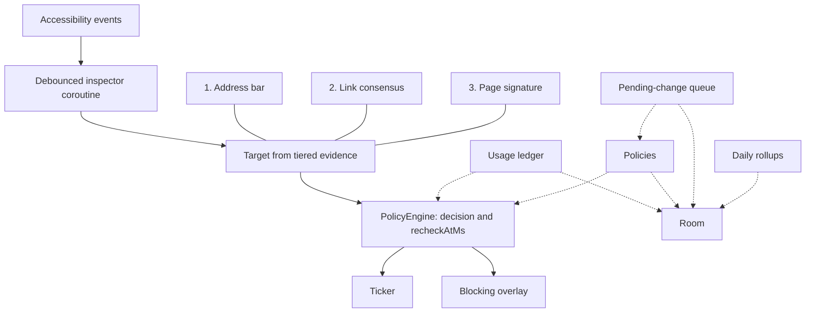

# How rotblock works

The enforcement path, how a target is identified, and the decisions behind them. What the
app does and how to install it are in the [README](../README.md).

## Architecture

`RotblockAccessibilityService` and its collaborators in `service/` are the only enforcement path. Accessibility callbacks do a set
lookup and hand the package to a conflated channel. The inspector coroutine, off that callback,
debounces and then reads the node tree at most once a second. A sustained scroll collapses
into one read.



The numbered nodes are evidence tiers, strongest first. They are not a pipe every read travels.

1. **Address bar.** A URL parsed out of the bar is a fact about the page. Text that does not parse
   (a half-typed search, a placeholder) is treated as unreadable, and an unreadable read holds the
   current target.
2. **Link consensus.** When the bar is absent — Samsung Internet removes the toolbar from the
   accessibility tree once you scroll — the host the page's own links agree on can acquire a
   target. It takes two consecutive scans of the same package (`LinkCorroboration`), it reports a
   host and no path, and it never overrides a bar that was read. A search-results page is refused
   by name, because every link on it agrees on the thing you searched for.
3. **Page signature.** The weakest tier, and the only one that can carry a path, which is how
   `youtube.com/shorts` can match on a browser whose bar reports a host alone. With the bar
   missing it is consulted *before* the link vote, because a miss falls through and a signature
   can name a path the vote is not allowed to. It may also refine a bar it already agrees with on
   host. It may not contradict one.

A feed whose view ids are on screen wins before any of the three. A read that cannot see answers
`Unreadable` and leaves the current target alone. `AppOnly` is the only answer allowed to clear it.

`PolicyEngine.evaluateAll` folds every policy covering that target — its own rule, and each group
it belongs to — with the ledger sessions and the pause and workout deadlines. The result is a
`Decision` plus `recheckAtMs`, the next time the answer could change with nobody touching the
phone. The service arms one ticker for that deadline. A block draws the overlay. A deadline
elapsing fires no event of its own; the next evaluation is what notices.

Room (`rotblock.db`) holds the policies, usage sessions, audit log, queued edits, and daily usage
rows. The usage ledger is the in-memory cache the service reads, flushed through to
`usage_sessions` so a quota survives a restart. `PendingChangeQueue` is the gate on edits: a
strengthening applies immediately, a weakening is parked until its deadline, and `applyDue` runs
when the service or the UI next looks at policies. `DailyRollup` folds completed days of
whole-phone usage into `daily_usage` from moments that are already awake — unlock, process start,
a tile binding, Insights opening.

### Design decisions

**Fail closed, by storing deadlines.** A pause is a timestamp. A queued weakening is a timestamp.
A quota is the stored sessions folded against the clock. A schedule is the one relaxation that is
not its own row: the wall clock is already durable, so "outside its hours" is derived on every
call, and an unparseable schedule decodes to always-on. After a crash or a reboot the same rows
are still there, so blocking resumes without a job putting it back. The trade-off is silence. Nothing
announces that a pause ran out or a window opened, so every decision owes the caller `recheckAtMs`.
Skip arming the ticker for it and a rule that should have returned simply never does.

**Decisions are pure functions of saved state.** `PolicyEngine` and `RollingQuota` take `nowMs`
and the stored rows. They do not read a timer, a database, or a boolean that says blocking is on.
The trade-off is that "are we blocked right now" means folding those rows again. That is also why
a restart produces the same answer: the inputs did not live in the process.

**No `INTERNET` permission.** The history this app keeps is the sensitive part, and a favicon
fetch would tell a server which sites are blocked. Logos come from an installed app that declares
the host, or from a monogram tile. Cloud backup and device-to-device transfer are excluded in
`app/src/main/res/xml/data_extraction_rules.xml`. The trade-off is no sync, and a website with no
installed app has no real logo.

**Nothing wakes the phone.** No alarms, no `WorkManager`, no wakelocks, no foreground service, no
boot receiver. The system rebinds the accessibility service on its own, so there is nothing to
restore at boot. Queued weakenings and daily rollups run opportunistically, while the process is
already awake, so a weakening that comes due while the phone is asleep waits until something next
looks, and the stricter rule stays in force until then. A finished day of Insights history waits
the same way, for the next unlock or the next time the app is open.

**A failed read holds the target.** `BrowserRegistry` and `FeedRegistry` are view ids that app
updates break. A miss can only fail to acquire a target, so it degrades to not blocked rather than
a crash or a false block. The opposite mistake — treating "I could not see" as "nothing is on
screen" — drops a live target, which is a fail-open. Those two outcomes stay distinct. The
trade-off is that a target acquired and then scrolled stays held until a real read says you left.

[`CLAUDE.md`](../CLAUDE.md) and [`.claude/rules/`](../.claude/rules/) are the full design record: the invariants, what breaks them, and the bugs
found on a real device.

## Fragile by nature

`browser/BrowserRegistry.kt` and `block/FeedRegistry.kt` hold view-ids that app updates break. They
are kept as data rather than scattered constants, and a miss degrades to "not blocked" rather than a
crash or a false block. To find current ids for a browser or feed that has drifted, open it and run:

```
adb shell uiautomator dump /sdcard/w.xml && adb pull /sdcard/w.xml
```
